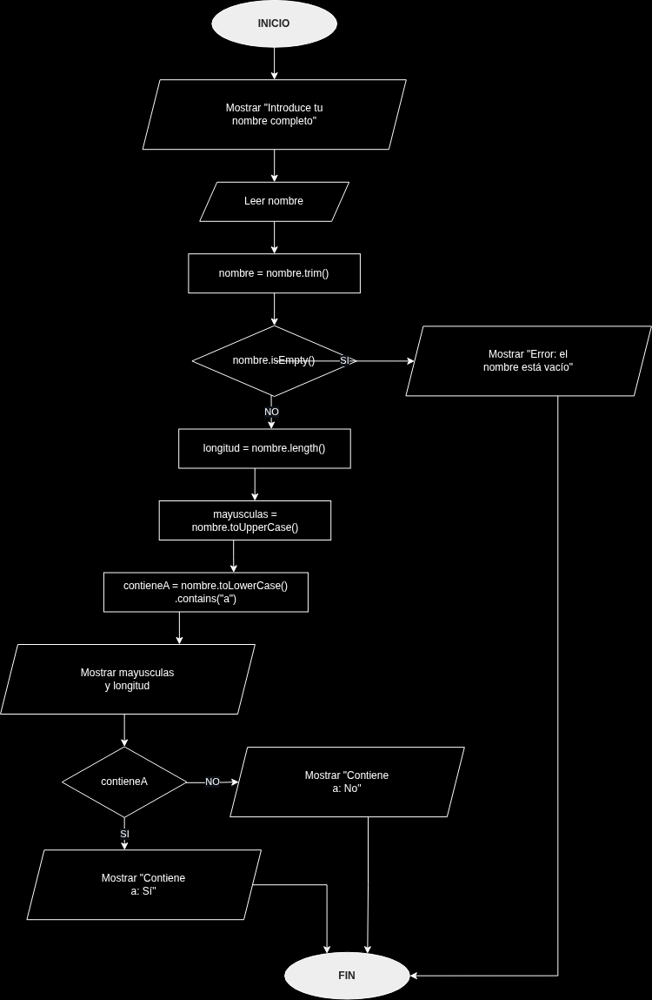
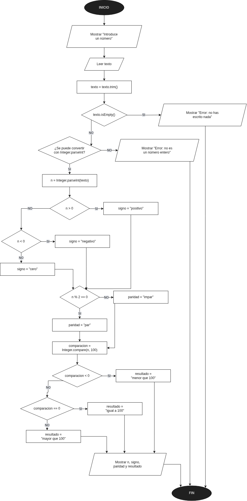
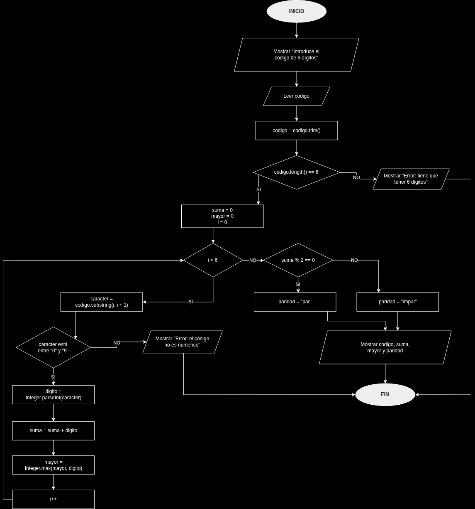

# Tarea 1 — Diagramas de flujo con `String` e `Integer`

**Módulo:** Entornos de Desarrollo (DAM)
**Unidad 5:** Elaboración de diagramas de comportamiento
**Autor:** Álvaro Hernández Oliva

En esta tarea he hecho tres diagramas de flujo en draw.io. No hay que programar nada, solo pensar cómo funcionaría cada algoritmo y dibujarlo con los métodos de String e Integer. En cada ejercicio pongo el enunciado, cómo lo he pensado, el diagrama y unas pruebas que he hecho a mano siguiendo las flechas.

## Símbolos que he usado

| Figura | Para qué la uso |
| --- | --- |
| Óvalo | El INICIO y el FIN |
| Paralelogramo | Cuando se lee algo o se enseña algo por pantalla |
| Rectángulo | Cuando se calcula algo o se guarda un valor |
| Rombo | Cuando hay una pregunta, y sale por SI o por NO |
| Flecha | Para ir de un paso al siguiente, y en el bucle para volver atrás |

---

## Ejercicio 1 — Analizador de nombres

### Enunciado

Diseña un algoritmo que solicite un nombre completo, lo normalice y muestre el nombre en mayúsculas, su longitud y si contiene la letra **a**, sin distinguir mayúsculas y minúsculas.

El algoritmo debe:

1. Leer el nombre completo como `String`.
2. Eliminar los espacios al principio y al final mediante `trim()`.
3. Comprobar si está vacío mediante `isEmpty()`. Si es así, mostrar un mensaje de error y finalizar.
4. Calcular su longitud con `length()` (contando los espacios interiores).
5. Transformarlo a mayúsculas con `toUpperCase()`.
6. Comprobar la presencia de la letra `a` mediante `toLowerCase()` y `contains("a")`.
7. Mostrar el nombre transformado, su longitud y el resultado de la comprobación.

### Qué pide, en resumen

Básicamente pides un nombre, le quitas los espacios que sobran y si hay algo escrito lo sacas en mayúsculas, dices cuántas letras tiene y si lleva alguna a.

### Definición del algoritmo

- **Entrada:** el nombre, que es un String.
- **Procesos:** quitar los espacios de los lados con trim, sacar la longitud con length, ponerlo en mayúsculas con toUpperCase y mirar si tiene una a con toLowerCase y contains("a").
- **Decisiones:** si el nombre está vacío y si tiene la a.
- **Salidas:** el nombre en mayúsculas, cuántos caracteres tiene y si tiene a o no.
- **Errores:** si no pones nada o solo espacios, al hacer el trim se queda vacío, sale un error y se acaba.

### Cómo lo he pensado

Lo primero es el trim, porque si alguien pone espacios al principio o al final se contarían en la longitud y no tiene sentido. Luego miro si se ha quedado vacío, y si es así error y fuera.

Si hay nombre, saco cuántos caracteres tiene y lo paso a mayúsculas. Para lo de la a lo paso antes todo a minúsculas, porque si no en "Ana" la A del principio no la pillaría. Y con "Luis", como no tiene ninguna a, en el rombo se va por el NO.

### Diagrama



### Pruebas

| Entrada | Resultado |
| --- | --- |
| "  Ana García  " | ANA GARCÍA, longitud 10, tiene a: Sí |
| "Luis" | LUIS, longitud 4, tiene a: No |
| "   " | Error, el nombre está vacío |

Con "  Ana García  " salen 10 porque el trim quita los espacios de fuera, pero el del medio se queda.

---

## Ejercicio 2 — Validador y clasificador de números

### Enunciado

Diseña **por tu cuenta** un algoritmo que reciba un entero como texto, valide la entrada, la convierta y muestre su clasificación.

**Requisitos obligatorios:**

1. Leer un valor como `String` y quitar los espacios exteriores mediante `trim()`.
2. Detectar la cadena vacía con `isEmpty()` y mostrar un error si procede.
3. Verificar que el texto representa un entero válido en el rango de `int`; si no, mostrar un error y finalizar. Puedes representar este control como una decisión «¿se puede convertir con `Integer.parseInt()`?»; en Java los errores de conversión provocan `NumberFormatException`.
4. Convertir el texto con `Integer.parseInt()`.
5. Determinar si el número es positivo, negativo o cero.
6. Determinar si es par o impar usando `% 2` (el cero es par).
7. Compararlo con `100` mediante `Integer.compare(numero, 100)`.
8. Mostrar el número convertido y las tres clasificaciones.

**Métodos obligatorios:** `trim()`, `isEmpty()`, `Integer.parseInt()` e `Integer.compare()`.

### Qué pide, en resumen

Te dan un número escrito como texto, miras que de verdad sea un número entero y si lo es dices si es positivo, negativo o cero, si es par o impar y si es menor, igual o mayor que 100.

### Definición del algoritmo

- **Entrada:** el texto que escribe el usuario, que es un String.
- **Procesos:** quitar los espacios con trim, pasarlo a número con Integer.parseInt, sacar el resto de dividir entre 2 y comparar con 100 usando Integer.compare.
- **Decisiones:** si está vacío, si se puede convertir a número, si es mayor que 0, si es menor que 0, si es par y cómo sale la comparación con 100.
- **Salidas:** el número, si es positivo, negativo o cero, si es par o impar y si es menor, igual o mayor que 100.
- **Errores:** si está vacío sale un error. Si tiene letras, decimales o es un número tan grande que no cabe en un int, no se puede convertir (en Java saltaría un NumberFormatException), así que también sale error y se acaba.

### Cómo lo he pensado

Primero le quito los espacios con el trim y miro que no esté vacío. Luego pregunto si se puede convertir a número antes de convertirlo, porque si alguien pone "hola" y lo intento pasar a número, peta.

Si se puede, lo guardo en n y voy mirando las cosas por partes:

1. Para el signo, si es mayor que 0 es positivo. Si no, miro si es menor que 0, y entonces es negativo. Y si no es ninguna de las dos, es el 0.
2. Para saber si es par miro el resto de dividir entre 2. Con el 42 da 0, así que es par, y con el -7 no da 0, así que es impar. El 0 también da resto 0, así que es par.
3. Para comparar con 100 uso Integer.compare, que te da un número negativo si es menor, 0 si es igual y positivo si es mayor. Con dos rombos ya salen las tres opciones.

Al final lo enseño todo junto.

### Diagrama



### Pruebas

| Entrada | Resultado |
| --- | --- |
| " 42 " | 42, positivo, par, menor que 100 |
| "-7" | -7, negativo, impar, menor que 100 |
| "0" | 0, cero, par, menor que 100 |
| "100" | 100, positivo, par, igual a 100 |
| "150" | 150, positivo, par, mayor que 100 |
| "hola" | Error, no es un número entero |
| "   " | Error, no has escrito nada |
| "2147483648" | Error, no cabe en un int |

---

## Ejercicio 3 — Analizador de códigos numéricos

### Enunciado

Diseña **por tu cuenta** un algoritmo que lea un código de **exactamente seis dígitos**, mantenga los posibles ceros iniciales y calcule la suma de sus dígitos, el mayor dígito y la paridad de la suma.

**Requisitos obligatorios:**

1. Leer el código como `String` y aplicar `trim()`.
2. Comprobar que `length()` devuelve exactamente `6`; si no, mostrar un error y finalizar.
3. Recorrer los seis caracteres mediante un bucle con índice de `0` a `5`.
4. Extraer cada dígito mediante `substring(i, i + 1)`.
5. Comprobar que cada fragmento representa un dígito del `0` al `9`. Si no, mostrar un error y finalizar; puedes comprobarlo antes de convertir o gestionar el error de `Integer.parseInt()`.
6. Convertir el fragmento mediante `Integer.parseInt()`.
7. Acumular la suma de los dígitos y actualizar el mayor mediante `Integer.max()`.
8. Determinar si la suma es par o impar mediante `% 2`.
9. Mostrar el código original, la suma, el mayor dígito y la paridad de la suma.

**Métodos obligatorios:** `trim()`, `length()`, `substring()`, `Integer.parseInt()` e `Integer.max()`.

**Importante:** conserva el código completo como `String`; si lo transformas a `int`, se perderían los ceros iniciales.

### Qué pide, en resumen

Te dan un código de 6 números, por ejemplo 002315, y tienes que sumar todos los números, decir cuál es el más grande y si la suma es par o impar, sin perder los ceros del principio.

### Definición del algoritmo

- **Entrada:** el código, que es un String. Lo dejo siempre como texto, porque si lo paso entero a int el 002315 se queda en 2315 y se pierden los ceros.
- **Variables del bucle:** i es la posición que voy mirando (de 0 a 5), caracter es el número que saco en cada vuelta, digito es ese número ya como int, suma es lo que llevo sumado, mayor es el número más grande hasta ese momento y paridad dice si la suma es par o impar.
- **Al empezar:** suma, mayor e i valen 0.
- **Dentro del bucle:** saco el carácter con substring(i, i + 1), lo paso a int con Integer.parseInt, lo sumo, actualizo el mayor con Integer.max y sumo 1 a la i.
- **Decisiones:** si tiene 6 caracteres, si i es menor que 6, si el carácter es un número del 0 al 9 y si la suma es par.
- **Salidas:** el código tal cual con sus ceros, la suma, el mayor y si la suma es par o impar.
- **Errores:** si no tiene 6 caracteres o si alguno no es un número, sale un error y se acaba.

### Cómo lo he pensado

Primero le quito los espacios con el trim y miro que tenga 6 caracteres. Si pones "123", como solo tiene 3, error y fin.

Luego pongo la suma, el mayor y la i a 0. El mayor puede empezar en 0 porque ningún número es negativo, así que el primero que salga ya va a ser igual o más grande.

Después viene el bucle. Mientras la i sea menor que 6 voy cogiendo los números de uno en uno. Con "204816", en la primera vuelta saco el 2, en la segunda el 0, y así hasta la sexta, que saco el 6.

En cada vuelta miro que lo que he sacado sea un número. Con "12A456", cuando llego a la A, error y fin. Si es un número, lo paso a int, lo sumo, miro si es el más grande y paso a la siguiente posición. La flecha vuelve arriba al rombo de i menor que 6.

Cuando la i llega a 6 se sale del bucle, miro si la suma es par y lo enseño todo.

### Diagrama



### Pruebas

| Entrada | Resultado |
| --- | --- |
| "204816" | suma 21, mayor 8, impar |
| "002315" | suma 11, mayor 5, impar |
| "000000" | suma 0, mayor 0, par |
| "123" | Error, no tiene 6 dígitos |
| "12A456" | Error, no es numérico |

En "002315" se quedan los ceros porque nunca paso el código entero a int. En "12A456" el error salta cuando llego a la A.

---

## Estructura del repositorio

```text
tarea-1/
├── README.md
└── diagramas/
    ├── ejercicio-1.drawio.png
    ├── ejercicio-2.drawio.png
    └── ejercicio-3.drawio.png
```

Los tres diagramas están hechos en draw.io y exportados con la opción de incluir una copia del diagrama, así que se pueden volver a abrir y editar.